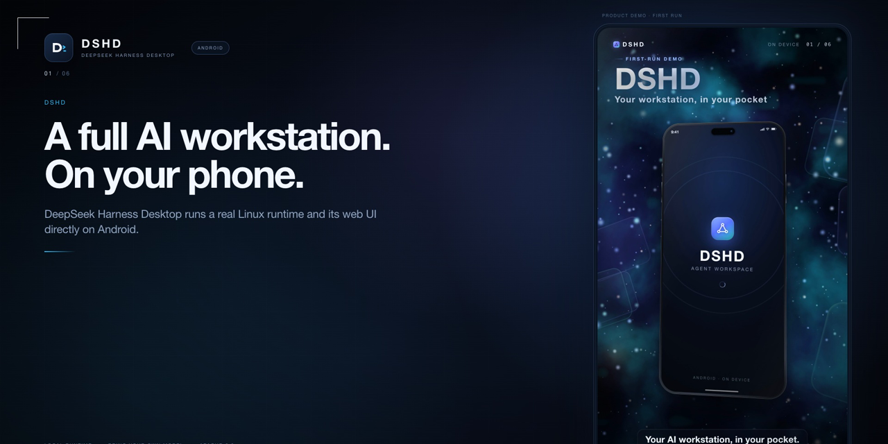

# DSHD for Android

[](https://github.com/openviewmobile/dshd-android/actions/workflows/android.yml)

English · [中文](README.zh.md)

**DSHD** stands for **DeepSeek Harness Desktop**. This project packages a
complete [DeepSeek Harness](https://github.com/deepseek-ai/deepseek-harness)
runtime into an ordinary Android APK: a Cortex/Ubuntu glibc userland, Node 24, the `dsh`
host and its web UI. No root, no Termux, no separate Linux installer.

- **Self-contained**: the default APK embeds a compressed rootfs and imports it
  on first launch.
- **Native shell**: Java + WebView; hardware back, file chooser, runtime
  permissions and storage selection are handled natively.
- **Polished launch**: a dark branded launch screen reports rootfs unpack and
  host-start progress, then fades only after the chat composer and history are
  ready. No white flash or `HARNESS` loading page is exposed.
- **Upgrade-safe**: the embedded image is SHA-256 versioned. An APK update
  replaces the rootfs and preserves `.dsh`, `Documents`, `workspace`, `.ssh`,
  `.gnupg` and `.npmrc`.
- **Chromium 92 compatible**: client bundles are patched for the Android
  WebView baseline (class static blocks, `v` RegExp flags, custom-scheme URL
  parsing, PDF worker polyfills).
- **Lite variant**: `DSHD_EMBED_ROOTFS=none` builds a ~1 MB APK for debugging
  with an external/imported rootfs.

## Demo



Separate language demos are generated locally by [demo/README.md](demo/README.md); large GIF/MP4 media is intentionally not stored in Git.

16:9 YouTube promo copy, thumbnails and chapter suggestions: [docs/youtube-promo.md](docs/youtube-promo.md). The MP4s are generated locally by `demo/youtube/render.mjs` and are not stored in Git. Startup
timings and the optimization boundary: [docs/startup-performance.md](docs/startup-performance.md).

## Architecture

```
Android APK
├── MainActivity (Java)          native tabs, dialogs, back, permissions
├── WebView                      dsh web UI on 127.0.0.1:3080
└── assets/rootfs.tar.xz         Cortex + Ubuntu 24.04 + Node 24 + dsh
        │ first launch / upgrade
        ▼
app-private rootfs ── ld.so + libcortex-hook.so ── node dsh web
```

The rootfs runs glibc ELF binaries directly through the rootfs loader and a
`LD_PRELOAD` path mapper. It does not use PRoot, so Android's `untrusted_app`
seccomp filter does not break `process.cwd()` or `package.json` reads.

## Install

Requirements: Android 9+ (API 28), arm64-v8a, about 1.5 GB free for the first
import, and a reachable OpenAI-compatible model endpoint.

1. Download `dshd-android-release.apk` from Releases.
2. Install and open it. A branded launch screen reports unpack/host progress;
   the first import typically takes 1–3 minutes on a phone.
3. Enter the base URL, API key and model id. The key is stored in
   Android Keystore-backed storage, not in the web UI.
4. Tap **SAVE AND START DSH**.

To update, install a newer APK over the old one. User data is preserved; the
old rootfs tree is removed only after the replacement succeeds.

## Build

```bash
# Lite debug APK (no rootfs)
DSHD_EMBED_ROOTFS=none scripts/build-apk.sh
adb install -r app/app/build/outputs/apk/debug/app-debug.apk

# Embedded release APK
DSHD_EMBED_ROOTFS="$PWD/dist/dshd-rootfs-arm64-webview-pnpm-appboot-mobile-fixed22-nativepdf.tar.xz" \
DSHD_KEYSTORE="$HOME/.dshd/android-release.jks" \
DSHD_KEYSTORE_PASSWORD=... DSHD_KEY_ALIAS=dshd-release DSHD_KEY_PASSWORD=... \
scripts/build-release-apk.sh
```

The default rootfs path is pinned in `app/app/build.gradle`. Rebuild the image
with `scripts/make-rootfs-archive.sh`; apply Chromium 92 patches with
`scripts/patch-rootfs-webview.sh` and `scripts/patch-rootfs-chromium92.sh`.

GitHub Actions builds the **lite debug APK** from source on push/PR and
uploads it as a workflow artifact with a SHA-256 file. Local `dist/` APKs are
never committed or uploaded. A full embedded-rootfs production APK still needs
a separately hosted rootfs and signing secrets; see [docs/release.md](docs/release.md).

See [docs/packaging.md](docs/packaging.md), [docs/architecture.md](docs/architecture.md),
[docs/testing.md](docs/testing.md) and [docs/release.md](docs/release.md) for details.

## Permissions

Six Android capabilities can be granted from **Permissions**:

| Capability | Android permission | Extra confirmation |
| --- | --- | --- |
| Microphone | `RECORD_AUDIO` | — |
| Camera | `CAMERA` | — |
| Location | fine/coarse location | yes |
| Notifications | `POST_NOTIFICATIONS` (Android 13+) | — |
| Bluetooth devices | scan/connect (or location on Android ≤ 11) | yes |
| Phone calls | `CALL_PHONE` | yes, warns that calls are dialed immediately |
| Contacts (read) | `READ_CONTACTS` | yes |

Denied permissions show **Grant**; granted rows show **Granted** and are not
clickable. Revoking in Android Settings is reflected on the next open.

## Known limitations

- arm64 only; no x86 emulator image is shipped.
- The embedded image targets a phone-sized WebView. Layouts are verified at
  375 and 320 CSS px, but very old WebViews (< Chromium 92) are unsupported.
- PDF pages are rendered as images by the Android `PdfRenderer` bridge, so
  text inside a PDF cannot be selected or copied. Large PDFs may be slow on
  low-end devices.
- The host UI is not fully localized; the separate-language guarantee covers
  the demo videos.
- The host listens on loopback only and is protected by a per-launch token.
- This is an independent project, not an official DeepSeek product.

## Contributing, security, license

- [CONTRIBUTING.md](CONTRIBUTING.md)
- [SECURITY.md](SECURITY.md)
- [CHANGELOG.md](CHANGELOG.md)
- Apache-2.0 for this repository; third-party components and the embedded
  Ubuntu userland keep their licenses. See [NOTICE](NOTICE) and
  [docs/third-party.md](docs/third-party.md).

Acceptance evidence for 0.3.2: [evidence/android-acceptance-0.3.2.md](evidence/android-acceptance-0.3.2.md).
Launch-screen evidence: [05-startup-overlay.png](evidence/acceptance-0.3.2/05-startup-overlay.png).
