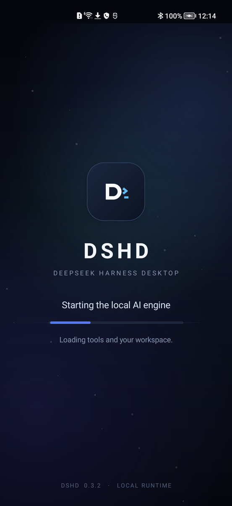
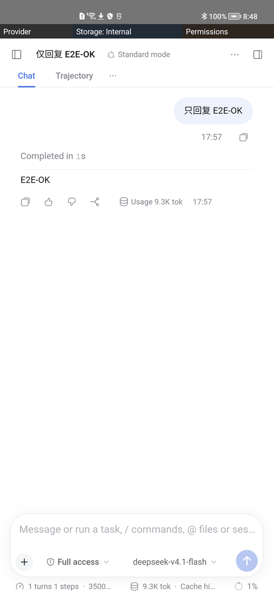

# DSHD for Android

**DeepSeek Harness Desktop — a real AI workstation on your Android phone.**

[**Download the current APK**](https://github.com/openviewmobile/dshd-android/releases/download/v0.3.2/dshd-android-release.apk) ·
[Install guide](#install) · [Screenshots](#screenshots) · [中文](README.zh.md)

[](https://github.com/openviewmobile/dshd-android/actions/workflows/android.yml)


DSHD packages a complete Linux runtime, Node.js, the DeepSeek Harness host and
its web UI into one APK. It runs on the phone itself: no PC, no root, no Termux,
no separate Linux installer.

> **Current download:** `0.3.2` with the full embedded runtime, built by GitHub
> Actions. This build is **production-signed** with the DSHD release key.
>
> APK: **144 MB** · SHA-256:
> `aa4e9783e7af547227f9c22970645cfe6daca41b54f11aed814a18b3c7ba3079`
> · [checksum file](https://github.com/openviewmobile/dshd-android/releases/download/v0.3.2/dshd-android-release.apk.sha256)

## What you get

- **A full workspace on the phone** — files, document/PDF preview, chat and a
  real terminal, served by a local `dsh` host.
- **Bring your own model** — connect any OpenAI-compatible endpoint. The API key
  is stored in Android Keystore-backed app storage.
- **No sidecar computer** — the Linux runtime is embedded in the APK and
  unpacked once on first launch.
- **Native Android shell** — back button, file chooser, permissions, notifications
  and storage selection all work without a browser wrapper around a desktop app.
- **Open source** — Apache-2.0; source, tests and release automation are public.

## Screenshots

| First launch | Chat workspace |
| --- | --- |
|  |  |

More evidence: [acceptance report](evidence/android-acceptance-0.3.2.md).

## Install

### Requirements

| | |
| --- | --- |
| Phone | Android 9+ (API 28), **arm64-v8a** |
| Storage | About 2 GB free for the first unpack |
| System | Android System WebView (Chromium 92 or newer) |
| Model | An OpenAI-compatible endpoint, API key and model id |
| PC | Not required |

### 1. Download

Open this link **on the Android phone**:

[**dshd-android-0.3.2-full-debug.apk**](https://github.com/openviewmobile/dshd-android/releases/download/v0.3.2/dshd-android-release.apk)

Or open the [release page](https://github.com/openviewmobile/dshd-android/releases/tag/v0.3.2)
and download the `.apk` asset. The `.sha256` file is next to it.

### 2. Allow installation

The APK is downloaded from GitHub, not Google Play. When Android asks, allow
your browser or file manager to **install unknown apps**, then open the APK.

If you previously installed a DSHD build signed with a different key (including
the old local test APK), Android may say **“App not installed”**. Uninstall the
old DSHD first. Uninstalling removes local app data, so back up files you need.

### 3. Open DSHD and wait for the first unpack

The first launch unpacks the embedded runtime. This usually takes **1–3 minutes**
and can take longer on a slow phone. Keep DSHD in the foreground while the
progress screen is visible. Later launches are much faster.

### 4. Connect a model

On the **Connect a model** screen enter:

- **Base URL** — your OpenAI-compatible endpoint, usually ending in `/v1`;
- **API key** — stored on the device, never written into the web UI;
- **Model id** — for example the model name provided by your service.

Tap **SAVE AND START DSH**. The local host starts and the workspace opens.

> DSHD runs the runtime and files locally. Prompts and any file context you send
> are transmitted to the model endpoint you configure. There is no DSHD cloud
> account and no model bundled with the APK.

## First things to try

1. Open **Files** and preview a text file or PDF.
2. Open the terminal and run `echo hello`.
3. Ask the model to read a workspace file.
4. Open **Permissions** to grant only the capabilities you need.

## Troubleshooting

| Problem | What to do |
| --- | --- |
| **App not installed** | You have an old DSHD with a different signature. Uninstall it first; this removes app data. |
| Download opens as text | Long-press the APK link → **Download link**; make sure the file ends in `.apk`. |
| First launch seems stuck | Give it 1–3 minutes, keep the app open, and make sure there is ~2 GB free. |
| Blank WebView / old UI | Update **Android System WebView** in the system app store, then reopen DSHD. |
| Provider connection fails | Check the base URL (often `/v1`), API key and model id; test the endpoint from another client. |
| Key rejected after restart | Re-enter the key in DSHD and save; the key is Keystore-backed, not stored in the web UI. |
| Need logs | `adb logcat -s dshd` while reproducing the issue. |

## Privacy and limitations

- The runtime and workspace live in app-private storage (or the storage location
  you select). API keys are Keystore-backed.
- Model prompts and attached context go to the endpoint you configure.
- Android permissions are granted individually; high-risk capabilities require
  an extra in-app confirmation.
- PDF pages are rendered natively as images: text inside a PDF cannot be
  selected or copied.
- Android 9+ arm64 only; x86 emulator images are not shipped.
- This is an independent project, not an official DeepSeek product.
- The current public APK is signed with the project release key; keep the
  checksum for verification.

## Build from source

For developers and maintainers:

```bash
# Lite debug build (no embedded rootfs)
DSHD_EMBED_ROOTFS=none scripts/build-apk.sh

# Full release build (local)
DSHD_EMBED_ROOTFS="$PWD/dist/dshd-rootfs-...tar.xz" \
DSHD_KEYSTORE=/secure/release.jks DSHD_KEYSTORE_PASSWORD=... \
DSHD_KEY_ALIAS=dshd-release DSHD_KEY_PASSWORD=... \
scripts/build-release-apk.sh
```

GitHub Actions builds a lite debug APK on every push/PR. The full embedded-rootfs
build and release path are documented in [docs/full-release.md](docs/full-release.md);
no local APK is committed or uploaded.

## Documentation

- [Documentation index](docs/README.md)
- [Architecture](docs/architecture.md) · [Packaging](docs/packaging.md) · [Testing](docs/testing.md)
- [Full release process](docs/full-release.md) · [Security audit](docs/public-repo-security.md)
- [Contributing](CONTRIBUTING.md) · [Security policy](SECURITY.md) · [Changelog](CHANGELOG.md)

## License

Apache-2.0 for this repository. The embedded Ubuntu userland and third-party
components keep their own licenses; see [NOTICE](NOTICE) and
[docs/third-party.md](docs/third-party.md).
