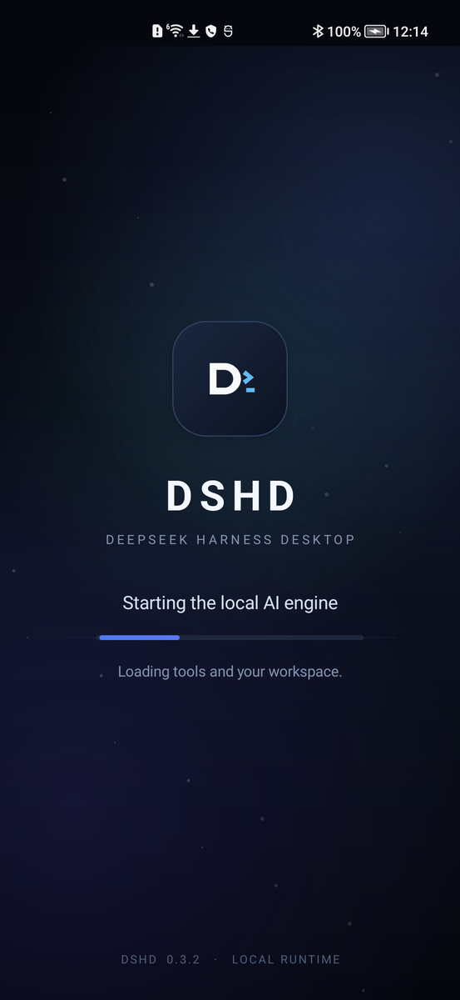
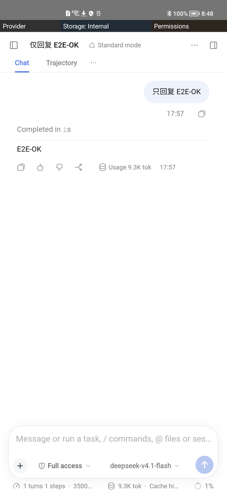

# DSHD for Android

**DeepSeek Harness Desktop —— 在 Android 手机上运行真正的 AI 工作站。**

[**下载当前 APK**](https://github.com/openviewmobile/dshd-android/releases/download/v0.3.2/dshd-android-release.apk) ·
[安装说明](#安装) · [界面截图](#截图) · [English](README.md)

[](https://github.com/openviewmobile/dshd-android/actions/workflows/android.yml)


DSHD 把完整的 Linux 运行时、Node.js、DeepSeek Harness Host 和 Web UI 打包进一个
APK。它直接运行在手机上：不需要电脑、不需要 root、不需要 Termux，也不需要另外
安装 Linux。

> **当前下载：** `0.3.2`，内置完整运行时，由 GitHub Actions 构建，使用
> **DSHD 发布密钥签名**。
>
> APK：**144 MB** · SHA-256：
> `aa4e9783e7af547227f9c22970645cfe6daca41b54f11aed814a18b3c7ba3079`
> · [校验文件](https://github.com/openviewmobile/dshd-android/releases/download/v0.3.2/dshd-android-release.apk.sha256)

## 你能得到什么

- **手机上的完整工作区**：文件、文档/PDF 预览、对话和真实终端，由本地 `dsh`
  Host 提供服务。
- **接入自己的模型**：支持任意兼容 OpenAI 接口的服务；API Key 保存在 Android
  Keystore 加密的应用存储中。
- **不需要另一台电脑**：Linux 运行时内置在 APK 中，首次启动解包一次。
- **原生 Android 外壳**：返回键、文件选择器、权限、通知和存储选择都可正常使用，
  不是套壳桌面应用。
- **开源**：Apache-2.0；源码、测试和发布流程公开。

## 截图

| 首次启动 | 对话工作区 |
| --- | --- |
|  |  |

更多验收证据见 [验收报告](evidence/android-acceptance-0.3.2.md)。

## 安装

### 设备要求

| | |
| --- | --- |
| 手机 | Android 9+（API 28），**arm64-v8a** |
| 存储 | 首次解包需要约 2 GB 可用空间 |
| 系统组件 | Android System WebView（Chromium 92 或更高） |
| 模型 | 兼容 OpenAI 接口的地址、API Key 和模型 ID |
| 电脑 | 不需要 |

### 第 1 步：下载

请用 **Android 手机**打开：

[**dshd-android-0.3.2-full-debug.apk**](https://github.com/openviewmobile/dshd-android/releases/download/v0.3.2/dshd-android-release.apk)

也可以打开 [Release 页面](https://github.com/openviewmobile/dshd-android/releases/tag/v0.3.2)
下载 `.apk`；同目录下有 `.sha256` 校验文件。

### 第 2 步：允许安装

这个 APK 从 GitHub 下载，不在 Google Play 上架。Android 提示时，请允许浏览器
或文件管理器**安装未知应用**，然后打开 APK。

如果你之前安装过其他签名的 DSHD（包括旧的本地测试 APK），系统可能提示
**“应用未安装”**。请先卸载旧版 DSHD。卸载会清除本地应用数据，请先备份需要的文件。

### 第 3 步：首次启动并等待解包

首次启动会把内置运行时解包到应用私有目录，通常需要 **1–3 分钟**，慢速手机上可能
更久。进度界面显示时请保持 DSHD 在前台。之后的启动会明显更快。

### 第 4 步：接入模型

在 **Connect a model** 页面填写：

- **Base URL**：兼容 OpenAI 接口的地址，通常以 `/v1` 结尾；
- **API key**：保存在设备上，不会写入 Web UI；
- **Model id**：你的服务提供的模型名称。

点击 **SAVE AND START DSH**，本地 Host 启动后就会进入工作区。

> DSHD 的运行时和文件在本地；你发送的提示词和文件上下文会传输到你配置的模型
> 服务端点。DSHD 没有云端账号，APK 也不内置任何模型。

## 第一次可以试什么

1. 打开 **Files**，预览一个文本文件或 PDF。
2. 打开终端，运行 `echo hello`。
3. 让模型读取工作区里的一个文件。
4. 打开 **Permissions**，只授予你实际需要的权限。

## 常见问题

| 问题 | 处理 |
| --- | --- |
| **应用未安装** | 旧版 DSHD 使用了不同签名。先卸载旧版；这会清除应用数据。 |
| 下载后打开是文本 | 长按 APK 链接选择**下载链接**，确认文件名以 `.apk` 结尾。 |
| 首次启动像卡住了 | 给它 1–3 分钟，保持前台，并确认有约 2 GB 可用空间。 |
| WebView 白屏/界面很旧 | 在系统应用商店更新 **Android System WebView**，再重新打开 DSHD。 |
| 模型连接失败 | 检查 Base URL（通常要 `/v1`）、API Key 和模型 ID；可先用其他客户端测试接口。 |
| 重启后 Key 失效 | 在 DSHD 里重新填写并保存；Key 由 Keystore 保管，不存 Web UI。 |
| 需要日志 | 复现时执行 `adb logcat -s dshd`。 |

## 隐私与限制

- 运行时和工作区保存在应用私有存储（或你选择的存储位置）；API Key 由 Keystore
  加密保存。
- 模型提示词和附件上下文会发送到你配置的模型端点。
- Android 权限逐项授予；高风险权限还会要求应用内二次确认。
- PDF 页面由原生渲染为图片，PDF 内文字暂不支持选择/复制。
- 仅支持 Android 9+ arm64；不提供 x86 模拟器镜像。
- 这是独立项目，不是 DeepSeek 官方产品。
- 当前公开 APK 使用项目发布密钥签名；下载后建议核对校验值。

## 从源码构建

面向开发者和维护者：

```bash
# Lite debug 包（不内置 rootfs）
DSHD_EMBED_ROOTFS=none scripts/build-apk.sh

# 完整本地 release 包
DSHD_EMBED_ROOTFS="$PWD/dist/dshd-rootfs-...tar.xz" \
DSHD_KEYSTORE=/secure/release.jks DSHD_KEYSTORE_PASSWORD=... \
DSHD_KEY_ALIAS=dshd-release DSHD_KEY_PASSWORD=... \
scripts/build-release-apk.sh
```

GitHub Actions 会在每次 push/PR 构建 lite debug APK。完整内置 rootfs 的构建与发布
流程见 [docs/full-release.md](docs/full-release.md)；仓库不提交也不上传本地 APK。

## 文档

- [文档索引](docs/README.md)
- [架构](docs/architecture.md) · [打包](docs/packaging.md) · [测试](docs/testing.md)
- [完整发布流程](docs/full-release.md) · [安全审计](docs/public-repo-security.md)
- [贡献指南](CONTRIBUTING.md) · [安全策略](SECURITY.md) · [更新日志](CHANGELOG.md)

## 许可证

本仓库使用 Apache-2.0。内置 Ubuntu 用户态和第三方组件遵循各自许可证；见
[NOTICE](NOTICE) 和 [docs/third-party.md](docs/third-party.md)。
